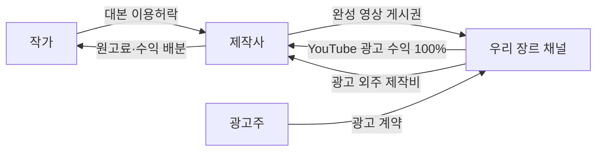

# 사업 모델: 작가 마켓 + 우리 소유 장르 채널 (초안 v0, 2026-10-15)

> Varev 결정. 영훈 님과 합의 전 초안이다. 배우(출연자·디지털 초상)는 이번 범위에서 뺀다.
> 관련: [작가 피드백 설계](writer-feedback.md), [베타 준비 점검](launch-readiness.md), [결정 기록](decisions.md).

## 한 줄 요약

작가는 대본을 올리고, 제작사는 대본을 골라 작가와 계약해 영상을 만들고, 그 영상은 **우리 소유의 장르 채널**에 올라간다.
영상의 YouTube 광고 수익은 **전액 제작 측(제작사·작가)에** 나누고, 채널이 커져 들어오는 **브랜드 광고 계약은 채널 주인인 우리가** 받아 제작사에 외주를 준다.

## 왜 이 구조인가

| 고민 | 이 구조의 답 |
|---|---|
| 중개만 하면 거래 뒤 수수료를 피해 떠난다 | 채널이 우리 것이라, 떠나면 채널의 시청자와 광고 일감을 잃는다 |
| 우리가 제작비를 대면 PD처럼 모든 위험을 진다 | 제작비는 제작사가 낸다. 우리는 대본을 사지 않는다 |
| 제작사는 남의 채널에 올리기 싫어한다 | YouTube 광고 수익 100%, 빠른 대본 수급, 광고 외주 일감으로 보상한다 |
| 흥행 정답 데이터가 없다 | 우리 채널의 모든 영상 성과를 소유자 권한으로 직접 본다. 같은 채널 안 비교가 자동으로 된다 |

## 누가 무엇을 주고받나

### 수익 항목별 몫

| 수익 | 받는 곳 | 나누는 법 |
|---|---|---|
| 일반 영상의 YouTube 광고 수익 | 우리 (채널 주인, 애드센스) | **전액** 제작 측에. 작가-제작사 계약의 배분율대로 작가와 제작사에 나눠 지급 |
| 브랜드 광고 계약 (채널 단위 협찬, 광고 영상) | 우리 | 우리가 수주하고 제작사에 외주 제작비를 준다. 우리 몫 = 광고비 − 외주비 |
| 광고 영상에 붙는 YouTube 광고 수익 | 우리 | 광고비에 포함된 것으로 보고 우리 몫 (제안. 계약에 명시) |
| 제작사 시리즈 안 PPL | 우리가 수주 | 기획 몫(우리)과 제작 몫(제작사)을 건마다 정한다. 기본 비율을 계약에 둔다 (제안: 제작 몫 70%) |
| 채널 멤버십·후원 | 우리 | 채널 단위 수입이라 우리 몫 |
| 원고료 | 제작사 → 작가 | 베타에서는 플랫폼 밖 지급, 기록만. 사업자 등록 뒤 에스크로 |
| 나중: 흥행 분석 도구, 작가 피드백 구독 | 이용자 → 우리 | 베타가 끝나고, 모델이 우리 채널 데이터로 검증된 뒤 |

- "영상 광고 수익은 영구히 100% 제작 측, 채널 단위 수입은 플랫폼 몫"으로 선을 계약서에 처음부터 적는다. 나중에 바꾸지 않는다.
- 새 채널은 수익 창출 조건을 넘기 전까지 광고 수익이 없다. 이 기간 제작사의 유인은 노출과 빠른 대본 수급이다. 계약서와 가입 안내에 밝힌다.

## 남게 만드는 장치 (위약금 없이)

- **광고 외주 일감 배정 기준을 공개**한다: 누적 성과 등급, 장르 적합도, 검수 위반 이력. 꾸준히 올린 제작사에게 먼저 간다.
- **시리즈 중심 편성**: 시청자가 다음 화를 찾아 채널로 온다. 쇼츠 단편보다 채널 충성도가 크다.
- 제작사가 떠나도 이미 올린 영상은 채널에 남고, 그 영상의 광고 수익 배분은 계속한다.
- 위약금·장기 독점처럼 묶어 두는 조항은 쓰지 않는다. 플랫폼 표준 계약은 약관으로 보아 불공정 조항이 무효가 될 수 있다.

## 위험과 대응

| 위험 | 대응 |
|---|---|
| 채널 소유자로서 저작권·음원·초상권·명예훼손 책임 | 업로드 전 검수, 제작사의 권리 보증·손해 배상 조항, 위반 시 게시 중단과 퇴출 |
| 한 제작사의 위반이 채널 전체를 위협 (저작권 경고 3회 = 채널 삭제) | 음원·소재 출처 제출 의무, 검수 체크리스트, 장르별 채널 분리 |
| 품질이 섞이면 채널이 약해짐 | 장르 채널마다 편성 기준. 나중에 흥행 모델이 편성 판단에 들어간다 |
| 뒷광고 | 공정위 추천·보증 심사지침: "유료 광고 포함" 설정과 영상 안 표기를 검수 항목으로 |
| 수익 창출 전 수입 없음 | 운영비 확보. 초기 몇 달은 아는 제작팀 위주로 업로드 수를 맞춘다 |
| 정산 시차 | 구글은 다음 달 지급. 확정 금액이 들어온 뒤 정산한다 (예상 수익으로 먼저 주지 않는다) |
| 세금 | 우리가 광고 수익을 받아 나눠 주므로 사업자 등록, 지급 시 원천징수·세금계산서. 세무 상담 |

## 계약 셋

| 계약 | 당사자 | 언제 | 핵심 조항 |
|---|---|---|---|
| 비밀유지 (NDA) | 제작사 → 작가 | 전문 열람 요청 때 (지금도 동의 체크가 있다) | 열람 목적 외 사용 금지, 아이디어·줄거리 무단 이용 금지, 기간, 위반 시 책임 |
| 대본 이용허락 | 작가 ↔ 제작사 | 협상 제안 수락 뒤 | 이용 범위(영상화, 형식, 회차), 기간, 독점 여부, 원고료, 광고 수익 배분율, 크레딧, 2차 이용, 우리 채널 게시 동의 |
| 채널 게시 | 제작사 ↔ 우리 | 첫 영상 제출 전 (한 번) | 게시권(기간·비독점), 광고 수익 100% 배분과 정산 주기, 채널 단위 수입은 우리 몫, 광고 외주 조건, 검수와 게시 중단, 권리 보증, 탈퇴 시 처리 |

계약서 초안은 문화체육관광부가 공개한 방송·영상 분야 표준계약서의 항목 구성을 참고해 쓰고, 우리 구조(채널 게시·100% 배분·광고 몫)는 직접 쓴다.

### 전자서명과 법률 검토

- 전자서명법(2020년 전부개정)에 따라 전자서명은 전자적 형태라는 이유만으로 효력이 부인되지 않는다. 공인인증서 같은 특별한 "권한"이 필요하지 않다.
  플랫폼 안에서 클릭으로 서명해도 계약은 성립한다.
- 관건은 **누가 서명했는지 증명**하는 것이다. 서명마다 계약서 본문의 해시, 서명 시각, 접속 정보, 서명자가 직접 입력한 이름, 동의 문구를 남긴다.
  본인확인(휴대폰 인증)이나 전자서명 전문 서비스를 붙이면 증명력이 더 강해진다(사업자 등록 뒤).
- 변호사 검토는 계약이 효력을 갖기 위한 요건이 아니다. 다만
  - 우리 구조(채널 게시·100% 배분·광고 몫)는 표준계약서에 없는 부분이라 직접 써야 하고,
  - 모든 이용자에게 같은 계약을 쓰면 약관으로 보아 약관규제법이 적용된다(불공정 조항 무효, 애매하면 작성자에게 불리하게 해석),
  - 이용약관과 개인정보 처리방침에는 법에 정한 기재 사항이 있다.
  그래서 위험은 "효력이 없다"가 아니라 "분쟁 때 일부 조항이 무효가 되거나 우리에게 불리하게 해석된다"이다.
- 결정: 베타는 초안 계약으로 시작하되 화면에 "베타 계약서 v0"를 밝히고, **돈이 플랫폼을 거쳐 오가기 전(정산 시작 전)에 한 번 검토**를 받는다.
  한국저작권위원회 등의 무료 상담을 먼저 활용한다.

## 베타에서 만드는 것 (작가·제작사만)

| 순서 | 기능 | 지금 코드 |
|---|---|---|
| 1 | 베타 모드: 출연자·캐스팅·흥행 판단 끄기, 코인 결제 끄기, 초대 코드 가입, 이메일 공개 필수 해제 | 기능은 있음, 스위치 없음 |
| 2 | 계약: 템플릿(버전), 딜 조건으로 채운 본문 고정, 양쪽 서명, 서명 기록, 계약서 보기 | NDA 동의 체크와 딜·라이선스 초안만 있음 |
| 3 | 영상 제출과 검수: 제작사가 딜에 묶인 영상(파일 또는 비공개 링크)과 권리 확인서를 제출 → 관리자 검수 → 우리 채널에 게시하고 YouTube 영상 번호 기록 | 없음 |
| 4 | 정산: 관리자가 월별 확정 수익을 영상마다 입력 → 배분율대로 작가·제작사 정산서 자동 작성 → 지급 기록 | 관리자 장부만 있음 |
| 5 | 작가 피드백 단계 0 | 설계만 |

- 베타에서 YouTube 업로드는 관리자가 직접 한다. API 자동 업로드는 Google의 API 심사를 받아야 공개 게시가 되므로 나중에 붙인다.
- 영상별 수익은 YouTube Studio 분석의 월별 확정 수익을 관리자가 입력한다. API 연동은 정책 확인 뒤.
- 2~4는 데이터베이스 구조 변경(`apps/api/prisma/`)이라 영훈 님 승인이 필요하다.

## 결정할 것

- 장르 채널 첫 장르와 이름, 채널을 만들 계정(브랜드 계정, 공동 소유자 지정)
- 광고 영상 YouTube 수익과 PPL 기본 비율 (위 제안값)
- 사업자 등록 시점 (정산 시작 전 필수)
